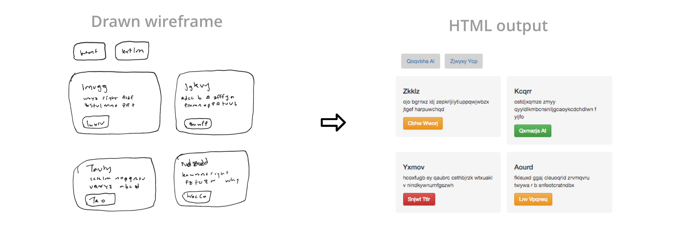

# SketchCode - An Amazing project

 

*Generating HTML Code from a hand-drawn wireframe*



> **Built in 2018, preserved as-is.** SketchCode came out of the Insight AI Fellowship, back when
> solving this meant training a model specifically for it. The technique of the moment was image
> captioning — a CNN encoder feeding an LSTM decoder — and the bet was that the same architecture
> would work if you treated HTML as the caption. It did, on wireframes close to the 1,700-image
> synthetic dataset it was trained on. The code targets TensorFlow 1.x and Keras of that era and is
> no longer maintained; it stands as a record of what this problem took before general-purpose
> vision-language models started doing it zero-shot.

SketchCode is a deep learning model that takes hand-drawn web mockups and converts them into working HTML code. It uses an image captioning architecture to generate its HTML markup from hand-drawn website wireframes.

For more information, check out this post: [Automating front-end development with deep learning](https://medium.com/insight-data/automated-front-end-development-using-deep-learning-3169dd086e82)

This project builds on the synthetically generated dataset and model architecture from [pix2code](https://github.com/tonybeltramelli/pix2code) by [Tony Beltramelli](https://github.com/tonybeltramelli) and the [Design Mockups](https://github.com/emilwallner/Screenshot-to-code) project from [Emil Wallner](https://github.com/emilwallner).

<b>Note:</b> This project is meant as a proof-of-concept; the model isn't (yet) built to generalize to the variability of sketches seen in actual wireframes, and thus its performance relies on wireframes resembling the core dataset.


## Setup
### Prerequisites

- Python 3 (not compatible with python 2)
- pip

### Install dependencies

```sh
pip install -r requirements.txt
```

## Example Usage

Download the data and pretrained weights:
```sh
# Getting the data, 1,700 images, 342mb
git clone https://github.com/ashnkumar/sketch-code.git
cd sketch-code
cd scripts

# Get the data and pretrained weights
sh get_data.sh
sh get_pretrained_model.sh
```

Converting an example drawn image into HTML code, using pretrained weights:
```sh
cd src

python convert_single_image.py --png_path ../examples/drawn_example1.png \
      --output_folder ./generated_html \
      --model_json_file ../bin/model_json.json \
      --model_weights_file ../bin/weights.h5
```


## General Usage

Converting a single image into HTML code, using weights:
```sh
cd src

python convert_single_image.py --png_path {path/to/img.png} \
      --output_folder {folder/to/output/html} \
      --model_json_file {path/to/model/json_file.json} \
      --model_weights_file {path/to/model/weights.h5}
```

Converting a batch of images in a folder to HTML:
```sh
cd src

python convert_batch_of_images.py --pngs_path {path/to/folder/with/pngs} \
      --output_folder {folder/to/output/html} \
      --model_json_file {path/to/model/json_file.json} \
      --model_weights_file {path/to/model/weights.h5}
```

Train the model:
```sh
cd src

# training from scratch
# <augment_training_data> adds Keras ImageDataGenerator augmentation for training images
python train.py --data_input_path {path/to/folder/with/pngs/guis} \
      --validation_split 0.2 \
      --epochs 10 \
      --model_output_path {path/to/output/model}
      --augment_training_data 1

# training starting with pretrained model
python train.py --data_input_path {path/to/folder/with/pngs/guis} \
      --validation_split 0.2 \
      --epochs 10 \
      --model_output_path {path/to/output/model} \
      --model_json_file ../bin/model_json.json \
      --model_weights_file ../bin/pretrained_weights.h5 \
      --augment_training_data 1
```

Evalute the generated prediction using the [BLEU score](https://machinelearningmastery.com/calculate-bleu-score-for-text-python/)
```sh
cd src

# evaluate single GUI prediction
python evaluate_single_gui.py --original_gui_filepath  {path/to/original/gui/file} \
      --predicted_gui_filepath {path/to/predicted/gui/file}

# training starting with pretrained model
python evaluate_batch_guis.py --original_guis_filepath  {path/to/folder/with/original/guis} \
      --predicted_guis_filepath {path/to/folder/with/predicted/guis}
```

## License

MIT — see [LICENSE](LICENSE).

Portions of this project derive from [pix2code](https://github.com/tonybeltramelli/pix2code), which
is licensed under the Apache License, Version 2.0. See [NOTICE](NOTICE) for the required
attributions and the terms that apply to those portions.
